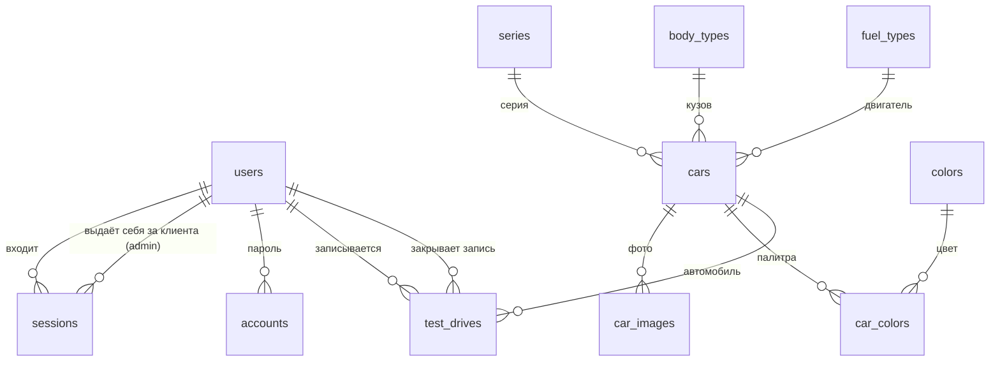

# Схема БД

12 таблиц, 12 связей. Источник истины — SQL-файлы в этой папке; после доработки они
превращаются в первую миграцию dbmate (`apps/api/db/migrations`).

Файлы здесь разбиты **по слоям** (таблицы → правила → справочник), потому что так
схему удобно читать целиком. Миграции разбиваются **по времени**, поэтому при переносе
слои схлопываются: `alter table ... add constraint` из `02_rules.sql` возвращаются
внутрь соответствующих `create table`, и первая миграция выглядит как одна готовая
схема, а не как её история. Отдельными миграциями остаётся только то, что появится
позже.

Перенос в первую миграцию сделан: [apps/api/db/migrations](../../apps/api/db/migrations).
Файлы в этой папке остаются как документация схемы по слоям — при следующих
изменениях редактируются они, а в код превращается уже итоговая правка.

| Файл | Что внутри | Куда |
|---|---|---|
| [01_tables.sql](01_tables.sql) | таблицы: PK, FK, UNIQUE, NOT NULL, DEFAULT | БД, миграция |
| [02_rules.sql](02_rules.sql) | CHECK, индексы, триггер `updated_at`, представление каталога | БД, миграция |
| [03_reference_data.sql](03_reference_data.sql) | серии, кузова, типы двигателя | БД, миграция |
| [schema.dbml](schema.dbml) | схема в DBML — только таблицы и связи | dbdiagram.io, черновая картинка |

Проверка ограничений в транзакции с откатом переехала в
[apps/api/test/db-smoke.sql](../../apps/api/test/db-smoke.sql): она гоняется поверх
seed-а (apps/api/db/seed), а не поверх пустых таблиц, поэтому теперь адресуется
к своим строкам по email/slug, а не по числовому `id`.

---

## Как смотреть схему

Визуальные редакторы разбирают SQL собственными парсерами и регулярно врут: теряют
`primary key` у колонок с `generated by default as identity`, а при экспорте
разворачивают внешние ключи в обратную сторону. Полную и честную картину даёт только
живая база — там схема уже существует, а не разбирается текстом.

```bash
docker run -d --rm --name cs-pg -p 5432:5432 -e POSTGRES_PASSWORD=pg postgres:17-alpine
cat 0[123]_*.sql | docker exec -i cs-pg psql -U postgres -v ON_ERROR_STOP=1
docker stop cs-pg
```

Дальше — **DBeaver** (`localhost:5432`, база `postgres`, пользователь `postgres`,
пароль `pg`):

- **связи:** двойной клик по схеме `public` → вкладка *ER Diagram*;
- **ограничения:** двойной клик по таблице → *Constraints* (PK, CHECK),
  *Foreign Keys*, *Indexes* — там видны и частичные уникальные индексы.

То же умеет pgAdmin 4. `schema.dbml` годится для быстрой картинки связей, но CHECK
и частичных индексов в DBML нет — как источник истины он не годится.

## Связи



Группы: **Better Auth** — `users`, `sessions`, `accounts`, `verifications`;
**справочники** — `series`, `body_types`, `fuel_types`; **каталог** — `cars`, `car_images`,
`colors`, `car_colors`; **записи** — `test_drives`.

Две связи `users → test_drives`: `user_id` — клиент, на кого запись, `closed_by` — кто
перевёл её в конечный статус (сам клиент при отмене или сотрудник).

Две связи `users → sessions`: `user_id` — чья сессия, `impersonated_by` — какой админ
вошёл под пользователем (admin-плагин Better Auth, D16); в обычной сессии — null.

`car_colors` — многие-ко-многим: у автомобиля несколько цветов, один цвет встречается
у нескольких автомобилей.

У `verifications` связей нет намеренно: код выписывается на адрес, которому может ещё
не соответствовать ни один пользователь.

## Ключи и имена

- Первичный ключ — **суррогатный**, колонка `id`. У прикладных таблиц
  `bigint generated by default as identity`, у таблиц Better Auth — `uuid`
  (тип ключа диктует библиотека).
- Внешний ключ называется `<таблица_в_единственном_числе>_id` и ссылается на `id`:
  `cars.series_id → series.id`. Никаких `id_car` рядом с `car_id` — иначе в каждом join
  приходится помнить, какое из двух имён где.
- Исключение — `car_colors`: там первичный ключ составной, `(car_id, color_id)`.
  Ключ и есть сама связь, отдельный суррогатный `id` ничего не добавил бы, а уникальность
  пары пришлось бы объявлять вторым ограничением.
- PK, FK и UNIQUE объявлены отдельными именованными ограничениями уровня таблицы.
  Для Postgres это то же самое, что запись внутри колонки, но так их понимают
  и внешние инструменты, а в ошибке видно имя нарушенного правила.
- `not null` у ключей написан явно, хотя `primary key` подразумевает его сам.

Почему суррогатные ключи, а не коды (`'suv'`, `'petrol'`) в роли PK: натуральный ключ
требует доказательства, что значение уникально и **никогда** не меняется. Для учебного
проекта это лишний спор на защите — `id` не требует обоснования вообще. Цена — join
со справочником там, где раньше хватало сравнения в `cars`; на каталоге из десятка
автомобилей она неизмерима.

Значение фильтра в URL — тоже `id` (`/catalog?body=6`). Фронт всё равно получает
справочники из `/api/catalog/filters` вместе с их `id`, так что подставить их в ссылку
ему ничего не стоит. Обратная сторона: если перенумеровать справочник, старые ссылки
молча покажут не то — поэтому **порядок строк в справочных данных
([03_reference_data.sql](03_reference_data.sql)) менять нельзя, только дописывать в конец**.

По той же причине справочники (серии, кузова, типы двигателя, цвета) не редактируются
через интерфейс и после появления управления каталогом (D26): сценария нет, а ошибка
в справочнике ломает фильтры всего каталога. Админ выбирает значения из готовых строк;
палитра автомобиля — это набор строк `car_colors`, сам `colors` не меняется.

Текстовый `slug` остался у `cars`: это адрес страницы (`/catalog/x5-xdrive40i`), им
делятся и его индексируют поисковики, там цифра была бы заметной потерей.

## Нормализация — решения

| Место | Решение | Почему |
|---|---|---|
| Характеристики и цена | прямо в `cars`, одна строка = один автомобиль с одной ценой | комплектаций в интерфейсе нет, отдельная таблица дала бы связь, за которой нет сценария |
| Серия, кузов, тип двигателя | таблицы-справочники, FK из `cars` | подпись и порядок в фильтре зависят только от справочника; иначе «Внедорожник (SAV)» повторялся бы в каждой строке (аномалия обновления) |
| Привод (`rwd`/`xdrive`) | колонка с CHECK, без справочника | два значения без собственных атрибутов и порядка; подписи — на фронте |
| Название и оттенок цвета | таблица `colors`, отдельно от `car_colors` | зависят только от цвета, а не от пары (автомобиль, цвет) |
| Палитра | `car_colors`, PK `(car_id, color_id)` | у связи нет собственных атрибутов |
| Обложка | не флаг, а `position = 1` | флаг «обложка» потребовал бы отдельного правила «ровно один на автомобиль» |
| 3D-модель | две nullable-колонки в `cars` + CHECK «обе или ни одной» | ради одного необязательного файла таблица 1:0..1 не окупается |
| Статусы записи и роли | CHECK, не таблицы | внутреннее состояние, подписи на фронте; формат роли диктует Better Auth |
| `test_drives.phone` | хранится отдельно от `users.phone` | это контакт для конкретной записи, самостоятельный факт, а не копия профиля |
| Окончание слота, длительность | не хранятся | выводятся из `starts_at` и константы 60 минут |
| Часы работы, горизонт, лимит | константы в API, не таблица настроек | менять их через интерфейс некому |
| Обложка и наличие 3D в каталоге | не хранятся, считаются в представлении `catalog_items` | производные значения |

Транзитивных зависимостей нет: каждый неключевой атрибут зависит от ключа своей таблицы
и только от него. Подписи справочников лежат в справочниках, характеристики автомобиля —
в `cars`, контакт записи — в `test_drives`.

## Что держит БД, а что API

**БД (декларативно):**

- форматы: email в нижнем регистре, телефон `+7XXXXXXXXXX`, slug, hex-цвет, пути к файлам
  (см. ниже);
- допустимые значения: роль, статус записи, привод;
- согласованность: данные блокировки только у заблокированного, пароль только у входа
  по паролю, путь к GLB вместе с именем материала, закрытая запись знает время и автора
  закрытия, причина только у отмены;
- **занятость слота** — частичный уникальный индекс
  `test_drives (car_id, starts_at) where status = 'scheduled'`. Он же снимает гонку двух
  одновременных записей: второй запрос получает `unique_violation` (23505), API переводит
  его в 409 `SLOT_TAKEN`. Проверять занятость отдельным `select` не нужно;
- у клиента не больше одной активной записи на одно время — такой же индекс по `user_id`.

**API (`apps/api/src/test-drives`):** сетка слотов 10:00–18:00 по часу, окно записи
(от +2 часов до +30 дней), лимит в 2 активные записи, переходы статусов и права
(клиент отменяет свою будущую запись, сотрудник ставит результат после начала слота).

Правила записи намеренно не продублированы триггерами: каждое правило в двух местах —
это два места, где оно разойдётся.

**Пути к файлам (обновлено D26).** В `car_images.path` и `cars.model_3d_path` лежит путь
целиком, фронт подставляет его как есть:

- `/assets/...` — файлы seed-а: заглушки в репозитории и `licensed-assets/` (D15.1, D25);
- `/media/cars/<carId>/<uuid>.<ext>` и `/media/models/<carId>/<uuid>.glb` — загруженные
  админом, объекты в MinIO (D26).

CHECK-и путей (`car_images_path_ck`, `cars_model_3d_path_ck`) допускают оба префикса:
`^/assets/...` и `^/media/cars/<carId>/<uuid>.(webp|avif|jpg|png)` /
`^/media/models/<carId>/<uuid>.glb`. Расширены миграцией
`apps/api/db/migrations/20261013120000_media_paths.sql`; формат `/media` уже, чем
у `/assets`, — ключи генерирует только API.

Объекты в MinIO БД не видит: внешнего ключа на файл не бывает. Поэтому файлы убирает
API — **после** коммита транзакции, которая перестала на них ссылаться (замена фото
или модели, удаление фото, автомобиля, модели). Если удаление объекта не удалось, ответ
всё равно успешный, в бакете остаётся сирота — это допустимо: лишний файл ничего не
ломает, а ссылка в БД на несуществующий файл сломала бы страницу. Пути `/assets/...`
API не удаляет никогда — эти файлы в гите или в `licensed-assets/`.

`cars.is_published` в схеме — `default true`: так seed получает опубликованный каталог
без лишней колонки в `insert`. Новая карточка из админки — черновик, API пишет `false`
явно, на default не полагается.

## Каскады

| Удаляется | Что происходит | Почему |
|---|---|---|
| пользователь | сессии и аккаунты — `cascade`; записи на тест-драйв и `sessions.impersonated_by` — `restrict` | удаления пользователей в интерфейсе нет, но история записей и кто кем притворялся не должны пропасть молча |
| автомобиль | фото и палитра — `cascade`; записи — `restrict` | удалять может админ (D26; раньше каталог был фиксированным). `restrict` от записей и есть правило «есть записи в любом статусе → не удалять»: API переводит его в 409 `CAR_HAS_TEST_DRIVES` (проверкой до удаления или по нарушению FK 23503), и такой автомобиль снимают с публикации. Фото и палитра без автомобиля смысла не имеют; строки `car_images` удаляет каскад, файлы в MinIO — API после коммита |
| цвет, серия, кузов, тип двигателя | `restrict` | справочные данные не удаляются, пока используются; через интерфейс они вообще не редактируются (D26) — палитра автомобиля меняется в `car_colors` |

## Открытые вопросы

1. **Телефон уникален?** Сейчас нет — два аккаунта могут иметь один номер.
2. **`ban_expires`** нужна admin-плагину Better Auth, а по сценариям блокировка бессрочная.
   Оставляем колонку как есть.
3. **Поиск по названию** — `ilike` по `cars.name`, автомобилей десятки, индекс не нужен.
4. ~~Состав колонок Better Auth сверить с `npx auth generate` на spike S2.~~ Сверено:
   `npx @better-auth/cli generate` потребовал 6 OAuth-колонок в `accounts`
   (`access_token`…`scope`, всегда `null` — соцвход выключен, D7) и `impersonated_by`
   в `sessions` (admin-плагин, D16). Обе правки внесены в `01_tables.sql`.
